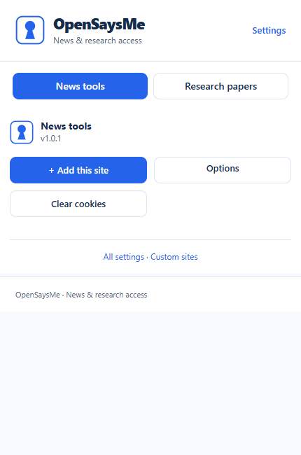
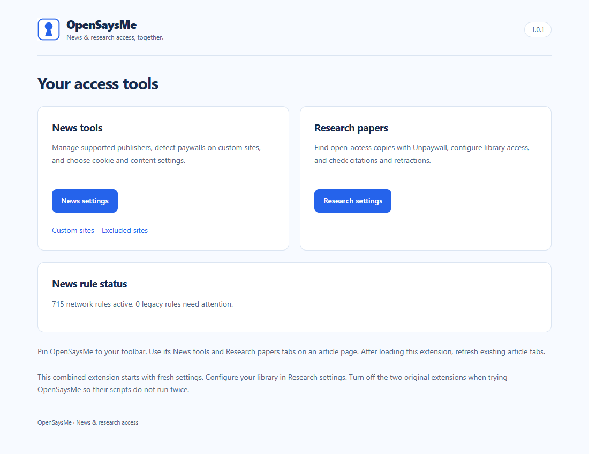

# OpenSaysMe


**News access tools and open-access research discovery in one browser extension.** OpenSaysMe combines Bypass Paywalls Clean's publisher and custom-site tools with Open Access Helper's research-paper lookup, with one popup and a consistent blue-and-white interface.

> **Use the `opensaysme-integration` branch.** This branch contains OpenSaysMe **1.0.1**. The repository's default `main` branch still contains the original Bypass Paywalls Clean extension.

## Install from GitHub

No build, terminal commands, Python, Node.js, installer, or administrator access is needed to use the extension.

1. **[Download the OpenSaysMe ZIP](https://github.com/NiceName570/bypass-paywalls-clean-ui/archive/refs/heads/opensaysme-integration.zip).** This link downloads the integration branch. If using GitHub's **Code → Download ZIP** menu instead, first select **`opensaysme-integration`** in the branch selector.
2. **Extract the ZIP** to a permanent folder. On Windows, right-click the ZIP and choose **Extract All**. Open the extracted folder and find **`manifest.json`**. It will normally be inside `bypass-paywalls-clean-ui-opensaysme-integration`. Keep this folder in place after installation.
3. **Open your browser's extensions page:**

   | Browser | Address to enter |
   | --- | --- |
   | Microsoft Edge — tested | `edge://extensions` |
   | Google Chrome — Chromium-compatible build; not tested here | `chrome://extensions` |

4. **Turn on Developer mode**, then click **Load unpacked**.
5. **Select the extracted folder that directly contains `manifest.json`.** Select the folder, not the ZIP, the manifest file, or its parent folder. The extension should appear as **OpenSaysMe**, version **1.0.1**, with the blue keyhole icon.
6. If the original **Bypass Paywalls Clean** or **Open Access Helper Web** extensions are installed, **turn them off while using OpenSaysMe** to prevent their scripts from running twice.
7. **Refresh any article tabs that were already open.** You can pin OpenSaysMe from the browser's Extensions menu for quick access.

Settings from the two original extensions are not imported automatically. Configure your library or institution again under **OpenSaysMe → Settings → Research settings** if you use those features.

## Use OpenSaysMe

Click the keyhole icon on an article page, then choose a tab:

| Tab | What it does |
| --- | --- |
| **News tools** | Controls supported publishers, detects settings for custom sites, and offers cookie cleanup. Use **Options** for publisher choices or **Custom sites** for your saved rules. |
| **Research papers** | Detects article DOIs and looks for open-access copies through Unpaywall. Research settings also expose institutional access, citations, retraction indicators, and page badges. |

**Settings** opens the common settings hub. The two components keep separate preferences, so resetting research settings does not erase news settings.

News rules can clear publisher cookies and page storage. Exclude sites where you want to keep an account signed in. **Clear cookies** also removes page storage and can sign you out. Custom-site detection uses heuristics; adding a site does not guarantee access. The research tab needs relevant article information, usually a DOI, to find a matching copy.

### Popup



### Settings



## Update an existing installation

1. Download the latest **integration-branch ZIP** using the link above and extract it.
2. Replace the files in the **same folder you originally loaded**. Keep that folder's location unchanged.
3. Open `edge://extensions` or `chrome://extensions`, find **OpenSaysMe**, and click **Reload**.
4. Refresh your open article tabs and reopen the popup.

For a Git checkout, update the integration branch with `git pull --ff-only`, then follow steps 3–4. Updating files and reloading the same installation keeps the extension's stored settings. This unpacked build does not update itself from GitHub or a browser store.

## Troubleshooting

- **“Manifest file is missing or unreadable”:** open the extracted folder and select the directory with `manifest.json` directly inside it. Loading the ZIP or the outer parent folder will not work.
- **OpenSaysMe is missing from the toolbar:** open the browser's Extensions menu and pin it. Check that it is enabled on the extensions page.
- **The popup lost its connection after a reload:** refresh that article tab. Reloading an extension does not add fresh content scripts to every already-open page.
- **The research tab is inactive:** try an article's landing page with a DOI. Browser settings pages and extension-store pages do not provide a normal article connection.
- **A publisher still shows a paywall:** check whether it is enabled in News settings. Try **Add this site** if it is not listed. Publisher changes and server-side restrictions can prevent a rule from working.
- **Edge still shows an older error entry:** old entries can remain after a fix. Clear the old entry once, reproduce the action, and check whether it returns. The tab-activation “Receiving end does not exist” warning is handled in this build and has a regression check.
- **Managed browser blocks unpacked extensions:** use a browser/profile where unpacked extensions are permitted, or contact its administrator. The legacy registry/allowlist files inherited from the original project are not installation steps for OpenSaysMe.

## Validation and known limits

Verified in an isolated **Microsoft Edge 155** profile on Windows:

- Manifest V3 service-worker registration and **715 accepted default network rules**.
- All eight interface screens, toolbar status icons, local resource loading, and updated branding across nine packaged languages.
- Settings isolation, publisher scoping, custom-site detection, article handling, exclusions, and cookie/storage cleanup.
- A controlled DOI-to-popup integration fixture and a **separate live Unpaywall lookup**.
- The missing-receiver messaging case: the earlier warning was reproduced before the fix, then the regression check passed with no unchecked messaging warnings.

The publisher rules are based on Bypass Paywalls Clean **2.7.1.1**; merging the components does not refresh every publisher's rule. Every publisher, redirect, library/EBSCO login, citation service, and retraction service has not been tested live. Chrome has not been tested here.

Manifest V3 uses declarative network rules. Bot user agents use desktop values, and random forwarding-header values refresh when rules rebuild rather than on every request. Inkl and Australian News Corp redirects that need URL decoding use observed navigation updates. Publisher-family discovery can add a newly inferred domain only after observing its identifying request.

## Development

All runtime files are already present. Installation does **not** require running these commands.

From the repository root, with Python 3 and Node.js 24 installed:

```text
python scripts/validate-files.py
node scripts/browser-check.mjs
```

The browser check currently requires Edge at its standard Windows installation path. It launches a separate temporary profile and does not install into your normal browser profile. It makes one live Unpaywall request. Generated results are written to `validation.json` and `artifacts/ui/`; these local outputs are ignored by Git.

`scripts/make-icons.py` exports the vector mark and PNG sizes and requires Pillow. `scripts/integrate.py` and `scripts/rebrand.py` record one-time integration/presentation work; they are **not build or installation steps** and can overwrite later edits if rerun.

## Credits and source versions

- **Bypass Paywalls Clean 2.7.1.1**, by magnolia1234, with NiceName570's custom-site UI: [original repository](https://github.com/NiceName570/bypass-paywalls-clean-ui/tree/main), baseline commit `7906e5eb934f064def3aa72e6d9b61c3af9c0429`. Its original MIT notice is preserved in [LICENSE](LICENSE).
- **Open Access Helper Web 2026.8**, by Claus Wolf: [Open Access Helper](https://www.oahelper.org/). The integration was made from the installed Edge package, extension ID `hflebgknodhdbgaogggfcahibddmjbii`.
- [DOMPurify](https://github.com/cure53/DOMPurify) is included with its upstream license notice in `lib/purify.min.js`.
- [Chrome's request-blocking migration guide](https://developer.chrome.com/docs/extensions/develop/migrate/blocking-web-requests) and [declarativeNetRequest reference](https://developer.chrome.com/docs/extensions/reference/api/declarativeNetRequest) informed the Manifest V3 port.

OpenSaysMe is a combined integration of those components. Original source attribution and license notices remain applicable to their respective files.
